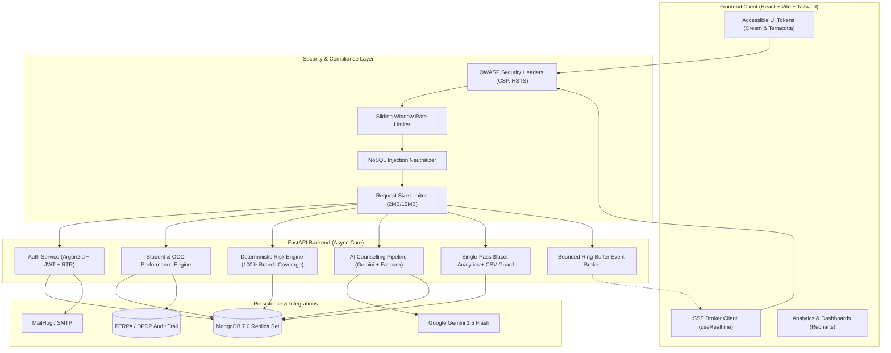

# AI-Based Student Dropout Prediction & Early Counselling System

[](#testing-and-verification)
[](#risk-engine-verification)
[](#security-audit)
[](LICENSE)

An enterprise-grade, privacy-compliant educational decision-support platform designed for higher education institutions. The system continuously evaluates multi-metric academic risk, provides explainable factor breakdowns, orchestrates real-time faculty notifications, and generates assistive counselling action plans.

---

## 🏛 System Architecture



---

## 🚀 Key Features

1. **Deterministic, Explainable Risk Engine**:
   - Zero hallucination risk scoring with mathematical boundary resolution (round-half-up).
   - Proportional weight redistribution for missing data points.
   - Non-negotiable override floors (e.g., attendance < 50% forces High Risk).
   - 3-point hysteresis margin preventing dashboard alert flapping.
   - **100% statement (288/288) and 100% branch (124/124) test coverage**.

2. **Optimistic Concurrency Control (OCC)**:
   - Atomic performance updates guarded by `If-Match` version headers.
   - Prevents lost updates during concurrent faculty grading sessions with HTTP `409 Conflict` resolution.

3. **Resilient AI Counselling Pipeline**:
   - PII-sanitized academic prompts powered by Google Gemini.
   - Immediate automatic fallback to factor-aligned templates on quota depletion or network failures.
   - Regex-based crisis phrase detection with immediate HOD escalation.
   - Append-only meeting notes timeline.

4. **Single-Pass Facet Analytics**:
   - High-performance multi-dimensional dashboard aggregations via MongoDB `$facet`.
   - CSV export protected against spreadsheet formula injection (`=`, `+`, `-`, `@`, `\t`, `\r`).
   - Short-term TTL caching with event-driven cache invalidation.

5. **Real-Time Server-Sent Events (SSE)**:
   - 500-event bounded ring buffer supporting disconnection replay via `Last-Event-ID`.
   - Dynamic delivery-time authorization (revoking student events immediately upon faculty reassignment).
   - In-app notification center with read states and unread counters.

6. **Enterprise Security & Privacy Compliance**:
   - FERPA & India DPDP compliance: automated audit logs on every access of High-risk student data.
   - Right of Access data portability (`GET /students/{id}/export-data`).
   - Right to Erasure with PII anonymization (`DELETE /students/{id}`).
   - OWASP security headers, sliding-window rate limiting, and recursive NoSQL injection rejection.

---

## 🏁 Quick Start with Docker Compose

Ensure [Docker](https://docs.docker.com/get-docker/) and [Docker Compose](https://docs.docker.com/compose/) are installed.

### 1. Launch the Application Stack

```bash
docker-compose up -d --build
```

The stack initializes the following services:
- **Frontend SPA**: [http://localhost:5173](http://localhost:5173)
- **FastAPI Backend**: [http://localhost:8000](http://localhost:8000)
- **Interactive API Docs**: [http://localhost:8000/docs](http://localhost:8000/docs)
- **MailHog Email Inbox**: [http://localhost:8025](http://localhost:8025)
- **MongoDB 7.0**: `localhost:27017`

### 2. Populate Demo Data

Run the automated synthetic dataset seeder to populate 200 realistic students, historical performance records, and counselling cases:

```bash
docker-compose exec backend python scripts/seed_demo_data.py
```

### 3. Demo Credentials

| Role | Email | Password | Scope |
| :--- | :--- | :--- | :--- |
| **Super Admin** | `admin@university.edu` | `AdminPass@123` | Institutional Master Access |
| **HOD (Computer Science)** | `hod.cs@university.edu` | `HodPass@123` | Department Scoped Analytics & Roster |
| **HOD (Electrical Eng.)** | `hod.ee@university.edu` | `HodPass@123` | Department Scoped Analytics & Roster |
| **Faculty 1** | `prof.sharma@university.edu` | `TeacherPass@123` | Assigned Mentorship Cohorts & Notes |
| **Faculty 2** | `prof.kapoor@university.edu` | `TeacherPass@123` | Assigned Mentorship Cohorts & Notes |
| **Demo Student** | `student.demo@university.edu` | `StudentPass@123` | Personal Academic Profile (CS2024-001) |

---

## 💻 Local Manual Development Setup

### Backend Setup

```bash
cd backend

# Create and activate virtual environment
python3 -m venv .venv
source .venv/bin/activate

# Install dependencies
pip install -e .

# Run development server
uvicorn backend.app.main:app --reload --host 0.0.0.0 --port 8000
```

### Frontend Setup

```bash
cd frontend

# Install Node dependencies
npm install

# Run Vite development server
npm run dev
```

---

## ⚙️ Environment Variables Reference

Create a `.env` file in the project root (sample provided in `.env.example`):

| Variable | Default Value | Description |
| :--- | :--- | :--- |
| `APP_NAME` | `student-dropout-system` | Application identifier |
| `APP_ENV` | `development` | Environment mode (`development`, `production`, `testing`) |
| `APP_DEBUG` | `true` | Enables detailed stack traces and documentation endpoints |
| `JWT_SECRET` | *(Random 64-char string)* | Cryptographic key for JWT access and refresh token signing |
| `MONGODB_URI` | `mongodb://localhost:27017` | MongoDB connection URI |
| `MONGODB_DATABASE` | `student_dropout_db` | Primary database name |
| `FRONTEND_URL` | `http://localhost:5173` | Allowed CORS frontend origin |
| `GEMINI_API_KEY` | *(Optional)* | Google Gemini AI key (falls back to template generator if unset) |
| `RATE_LIMIT_ENABLED` | `true` | Toggles in-memory sliding window rate limiter |
| `RATE_LIMIT_AUTH_PER_MINUTE` | `30` | Max requests per minute on authentication routes |
| `RATE_LIMIT_GLOBAL_PER_MINUTE` | `240` | Max requests per minute on general API routes |

---

## 🧪 Testing and Verification

### Backend Automated Test Suite (127 Tests)

```bash
./backend/.venv/bin/pytest backend/tests/ -v
```

### Risk Engine 100% Branch Coverage Verification

```bash
./backend/.venv/bin/pytest backend/tests/test_risk_scenarios.py --cov=backend/app/risk --cov-branch --cov-report=term-missing
```

### Static Application Security Testing (Bandit)

```bash
./backend/.venv/bin/bandit -r backend/app -ll
```

### High-Concurrency Load Simulation (Locust)

Simulates 500 concurrent users accessing dashboards, rosters, risk engines, and reports:

```bash
./backend/.venv/bin/locust -f load_tests/locustfile.py --headless -u 100 -r 10 --run-time 30s --host http://localhost:8000
```

### Frontend Build & Linting

```bash
cd frontend
npm run lint
npm run build
```

---

## 🛡 Ethical Guidelines & Decision Support Notice

> [!IMPORTANT]
> **Advisory Decision Support Disclaimer**
>
> All risk scores, percentage ratings, and automated AI counselling suggestions generated by this platform are designed strictly as **advisory assistive tools for educational professionals**.
>
> They **do not constitute automated educational decisions**, academic judgments, or disciplinary determinations. Faculty and institutional mentors retain sole authority in pedagogical interventions, student evaluations, and career guidance.

---

## 📄 Database Maintenance Scripts

- **Daily Backup**: `./scripts/backup_mongodb.sh` (creates timestamped, gzip-compressed dumps with 30-day automatic retention pruning).
- **Tested Restore**: `./scripts/restore_mongodb.sh <backup_folder_path>` (safely recovers collections with namespace isolation).
- **Synthetic Dataset Seeding**: `./scripts/seed_demo_data.py` (generates 200 multi-tiered demo profiles).
